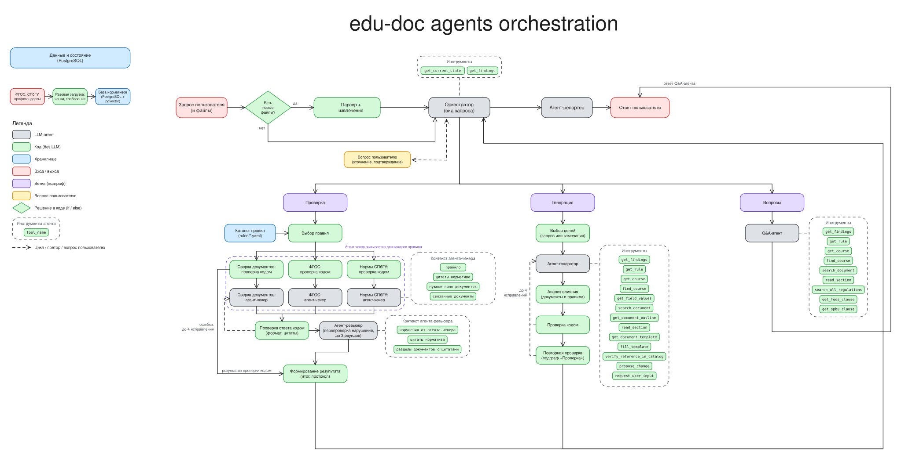

# ADR-0003: Оркестрация агентов на LangGraph и LangChain

- Статус: предложено
- Дата: 2026-10-24
- Обновлено: 2026-11-17 (по ревью PR #16 и ADR-0005)
- Участники: Карим М (автор)

## Контекст

Документ описывает граф оркестрации: какие агенты и шаги кода обрабатывают запрос
пользователя, как они взаимодействуют и какими инструментами пользуются.

- Среда выполнения графа описана в [архитектуре бэкенда](../backend-architecture.md): воркер ARQ
  запускает граф, Checkpointer сохраняет состояние в PostgreSQL, пауза для ответа пользователя
  переводит run в статус `waiting_for_input`.
- Данные программы приходят из модуля извлечения ([ADR-0002](0002-extraction-hybrid.md),
  `extraction/models.py`).
- Поиск по нормативам описан в [ADR-0005](0005-rag-normatives.md).

## Общая схема

Оркестратор относит запрос пользователя к одному из видов и запускает соответствующие подграфы:

- вопрос: «Вопросы»;
- проверка документов: «Проверка»;
- изменение документов: «Генерация»;
- проверка с исправлением: «Проверка», затем «Генерация».

Подграф представляет собой заданную последовательность агентов и шагов кода:

- «Проверка»: агент-чекер и агент-ревьюер;
- «Генерация»: агент-генератор;
- «Вопросы»: Q&A-агент.

Оркестратор и агент-репортер работают вне подграфов. Оркестрация реализована на LangGraph и
LangChain.



## Обработка запроса пользователя

1. Пользователь направляет запрос с файлами или без них.
2. Парсер извлекает данные из загруженных документов и сохраняет их в базе данных. В повторном
   запросе обрабатываются только новые документы, остальное берётся из базы данных.
3. Оркестратор определяет вид запроса и объём работы (`Scope`): дисциплины, наборы правил,
   замечания или цель изменения. Если запрос неясен, оркестратор задаёт уточняющий вопрос.
4. Код запускает подграфы по очереди.
5. Если подграфу не хватает данных (например, кода направления), оркестратор запрашивает их у
   пользователя, и подграф продолжает работу.
6. По завершении обработки ответ на вопрос формирует Q&A-агент, протокол проверки или перечень
   изменений формирует агент-репортер.

Состояние сохраняется после каждого шага. В нём хранятся только ID документов, замечаний и
изменений. Последующие запросы по тому же пакету документов
обрабатываются на основе сохранённого состояния. При сбое выполнение возобновляется с последнего
завершённого шага.

## Каталог правил

Каждое требование ФГОС, норм СПбГУ и профстандартов записывается как отдельное правило в
YAML-файле. В правиле указано, что проверить и каким способом (поле `method`):

- `code`: правило проверяет код. Так проверяется всё, что можно посчитать или сравнить:
  трудоёмкость, часы, наличие разделов, коды компетенций.
- `llm`: правило проверяет LLM. Так проверяется смысл текста, который код оценить не может,
  например, раскрывают ли результаты обучения индикаторы компетенций. LLM получает формулировку
  правила, цитату норматива и нужные поля документов.

Правила обоих видов хранятся в одном файле вперемешку, способ проверки указан в каждом правиле.
Файлы разделены по источнику требований:

- `rules/fgos/<код направления>.yaml`: ФГОС, отдельный файл для каждого направления;
- `rules/spbu.yaml`: нормы СПбГУ и профстандарты;
- `rules/cross_check.yaml`: сверка документов между собой, например, совпадает ли трудоёмкость
  дисциплины в учебном плане и РПД. У этих правил нет цитаты норматива.

Файл ФГОС выбирается по коду направления (`ProgramInfo.direction_code`). Если код направления не
найден в документах, оркестратор запрашивает его у пользователя; без него правила ФГОС получают
результат `not_checked`, и проверка считается неполной.

Если поле не удалось извлечь из документа, правила, которым оно нужно, получают результат
`not_checked` с причиной «не удалось прочитать».

**Как составляется правило.** Разработчики заранее пишут в `validation/checks/` общие функции
проверки. Конкретные числа функция получает из правила. Упрощённо:

```python
def equals(document, field, expected):
    return getattr(document, field) == expected
```

Администратор читает норматив, например ФГОС направления 09.03.03: «Объём программы бакалавриата
составляет 240 зачётных единиц». Он записывает правило: какую функцию вызвать, с какими
параметрами, и цитату пункта:

```yaml
- id: fgos-09.03.03-total-credits
  title: Объём программы 240 з.е.
  rule_set: fgos
  applies_to: program
  doc_kinds: [curriculum]
  method: code
  check: equals
  params: {field: total_credits, expected: 240}
  severity: error
  fixable: false
  requirement:
    quote: "Объём программы бакалавриата составляет 240 зачётных единиц"
    clause_id: "1.8"
    edition: "<редакция>"
```

Если в итоговой строке учебного плана 236 з.е., в протокол попадает замечание с этой цитатой.

Примерный набор функций:

| Функция | Что проверяет | Пример правила |
| :--- | :--- | :--- |
| `equals` | Значение поля равно числу | Объём программы 240 з.е. |
| `at_least` | Значение поля не меньше числа | Блок 1 не менее 160 з.е. |
| `hours_match_credits` | Часы равны з.е., умноженным на число | 1 з.е. равна 36 часам |
| `parts_sum_to_total` | Части дают в сумме итог | Часы по темам дают общую трудоёмкость |
| `sections_present` | В документе есть все перечисленные разделы | Обязательные разделы РПД |
| `codes_in_list` | Все коды документа есть в списке | Коды УК и ОПК в РПД есть во ФГОС |
| `all_codes_covered` | Каждый код из списка встречается хотя бы раз | Каждая компетенция ФГОС закреплена за дисциплиной |
| `values_match_across_documents` | Значение поля совпадает в двух документах | З.е. дисциплины в учебном плане и РПД |

Если требование не сводится ни к одной функции, его записывают как правило `method: llm` с
формулировкой в `criterion` или разработчики добавляют новую функцию.

Примеры правил:

```yaml
- id: spbu-rpd-hours-per-credit
  title: Трудоёмкость в часах соответствует зачётным единицам
  rule_set: spbu
  applies_to: course
  doc_kinds: [discipline]
  method: code
  check: hours_match_credits
  params: {hours_per_credit: 36}
  severity: error
  fixable: true
  requirement:
    quote: "<дословная цитата пункта норматива>"
    clause_id: "<номер пункта норматива>"
    edition: "<редакция>"

- id: spbu-rpd-outcomes-match-indicators
  title: Результаты обучения раскрывают индикаторы компетенций
  rule_set: spbu
  applies_to: course
  doc_kinds: [discipline]
  method: llm
  criterion: "Каждый результат обучения конкретизирует индикатор, к которому он отнесён."
  fields: [indicators, learning_outcomes]
  severity: warning
  fixable: true
  requirement:
    quote: "<дословная цитата пункта норматива>"
    clause_id: "<номер пункта норматива>"
    edition: "<редакция>"

- id: cross-check-credits-plan-vs-rpd
  title: Трудоёмкость дисциплины совпадает в учебном плане и РПД
  rule_set: cross_check
  applies_to: documents
  doc_kinds: [discipline]
  method: code
  check: values_match_across_documents
  params: {field: credits}
  severity: error
  fixable: true

- id: cross-check-prerequisites-prepare
  title: Содержание пререквизитов готовит к изучению дисциплины
  rule_set: cross_check
  applies_to: documents
  doc_kinds: [discipline]
  method: llm
  criterion: "Темы и результаты обучения пререквизитов дают то, на что опирается дисциплина."
  fields: [prerequisites, topic_hours, learning_outcomes]
  severity: warning
  fixable: false
```

| Поле | Тип | Назначение |
| :--- | :--- | :--- |
| `id` | `str` | Уникальный ID правила |
| `title` | `str` | Формулировка для протокола |
| `rule_set` | `fgos` / `spbu` / `cross_check` | Набор правил |
| `applies_to` | `course` / `program` / `documents` | Уровень: одна дисциплина, программа целиком, группа связанных документов |
| `doc_kinds` | `list[str]` | Виды документов, к которым применяется правило (`discipline`, `practice`, ...) |
| `method` | `code` / `llm` | Кто проверяет правило |
| `check` | `str` | Имя функции проверки в `validation/checks/` (для `method: code`) |
| `params` | `dict` | Параметры функции проверки |
| `criterion` | `str` | Формулировка критерия для LLM (для `method: llm`) |
| `fields` | `list[str]` | Поля извлечённых данных документов, которые передаются агенту-чекеру в контекст (для `method: llm`) |
| `severity` | `error` / `warning` | Критичность замечания |
| `fixable` | `bool` | Можно ли исправить замечание подграфом генерации |
| `requirement` | `Requirement \| None` | Дословная цитата норматива, номер пункта и редакция норматива; для набора `cross_check` не заполняется |

**Контекст для правил `method: llm`** собирает код по `applies_to` и `fields`:

- `course`: поля одной дисциплины;
- `program`: данные учебного плана и сводка по всем дисциплинам;
- `documents`: поля всех загруженных документов.

Противоречия, которые не описаны отдельными правилами, ищет общее правило
`cross-check-contradictions` (`applies_to: documents`, `severity: warning`): «найди смысловые
противоречия между загруженными документами».

## Подграфы

### Проверка

Проверка идёт параллельно по наборам правил: ФГОС, нормы СПбГУ и сверка документов между собой.
Все наборы устроены одинаково: правила `method: code` проверяет код, правила `method: llm` проверяет агент-чекер.

1. Код выбирает правила по `Scope` и коду направления. Если для правила не загружен нужный
   документ, оно получает результат `not_checked` с причиной. Например:
   - дисциплина есть в учебном плане, но её РПД не загружена;
   - нет учебного плана.
2. Правила с `method: code` проверяет код по всем дисциплинам из области проверки. Агент-ревьюер
   эти замечания не перепроверяет, они сразу попадают в результат.
3. Правила с `method: llm` проверяет агент-чекер. Это один агент, который запускается параллельно
   для каждой пары «правило, единица проверки»: дисциплина, группа связанных документов или
   программа (по `applies_to`). Контекст собирает код: правило, цитату норматива и поля документов
   из `fields`. Агент возвращает решение: выполнено или нарушено, с дословными цитатами из
   документов.
4. Ответ агента-чекера проверяет код: формат ответа, что указанные дисциплины существуют и что
   цитаты дословно встречаются в документах. Если значения в документах расходятся, нужна цитата
   из каждого документа. Если чего-то не хватает, нужна одна цитата и название документа, где этого
   нет. Если есть ошибки, чекер исправляет ответ, всего не более 4 раз; после этого правило получает
   результат `not_checked`.
5. Агент-ревьюер пытается опровергнуть каждое найденное нарушение и объясняет, почему не согласен.
   Он видит целиком разделы документов, из которых взяты цитаты. Чекер получает объяснение и
   снимает нарушение или оставляет его со своим объяснением, которое получает ревьюер. Если за 3 раунда агенты не согласились, замечание
   попадает в протокол с пометкой «требует проверки человеком» и мнениями обоих агентов.
6. Код объединяет одинаковые замечания и формирует результат: перечень замечаний, результат по
   каждому правилу и итог: число нарушений и число правил с результатом `not_checked`. В результате
   указываются версия каталога правил и редакции нормативов.

### Генерация

Подграф отвечает за любое изменение документов: создание недостающих разделов, титульных листов,
пояснительных записок и сводных таблиц, исправление замечаний и правку по запросу пользователя.

1. Код определяет цели: по запросу пользователя или по замечаниям с `fixable: true`.
2. Агент-генератор находит изменяемый элемент (по неточному названию дисциплины, фрагменту
   текста, значению поля) и готовит точечные правки: какое значение в данных заменить и на что.
   Если цель неоднозначна или в документах не хватает
   данных, агент передаёт оркестратору вопросы или варианты, и оркестратор запрашивает их у
   пользователя.
3. Код определяет всё, на что влияет изменение: то же значение в других документах,
   вычисляемые значения, итоговые показатели и правила, которые используют изменённые данные.
4. Правки вносятся в черновую копию данных. Код проверяет черновик и документы, на которые
   повлияло изменение, правилами `method: code`. Если проверка не пройдена, изменение
   возвращается агенту-генератору.
5. Затем подграф «Проверка» один раз проверяет черновик по затронутым дисциплинам и правилам.
   Если исправляемое замечание осталось или появились замечания, которых не было до изменения,
   изменение тоже возвращается агенту-генератору.
6. Всего агент-генератор исправляет изменение не более 4 раз. После этого подграф возвращает
   оркестратору ошибку с перечнем проблем.
7. Подграф возвращает оркестратору изменение: правки (было, стало) и перечень последствий.

Оркестратор показывает пользователю правки (было, стало) и последствия и запрашивает
подтверждение. После подтверждения правки вносятся в данные. При отказе черновик удаляется.

Если пользователь просит доработать изменение, оркестратор повторно запускает подграф с его
комментарием.

### Вопросы

Q&A-агент отвечает на вопросы о программе, замечаниях и нормативных документах. Данные программы,
замечания и правила он получает через свои инструменты, поиск по нормативным документам выполняет
через RAG-компонент. Агент только читает данные.

## Обращения к пользователю

| Ситуация | Кто спрашивает | Когда |
| :--- | :--- | :--- |
| Запрос неясен или отсутствует необходимый документ | Оркестратор | До запуска подграфа |
| Не найден код направления для правил ФГОС | Оркестратор | До запуска подграфа «Проверка» |
| Подграф сообщил о недостающих данных или неоднозначной цели | Оркестратор | После возврата результата подграфом |
| Подтверждение изменения | Оркестратор | После возврата результата подграфом «Генерация» |

## Повторы и восстановление

Ошибка одного шага не приводит к перезапуску графа или подграфа.

| Сбой | Что происходит |
| :--- | :--- |
| Временная ошибка LLM (таймаут, 429, 5xx) | Повтор запроса в `llm/`, до 4 попыток с паузой. Затем правило получает `not_checked` |
| Ответ LLM не проходит схему Pydantic | Повтор того же вызова с текстом ошибки, до 4 раз. Затем правило получает `not_checked`, граф продолжает работу |
| Ответ чекера не прошёл проверку кодом | Исправление чекером по замечаниям кода, до 4 раз. Затем `not_checked` |
| Ревьюер оспорил нарушение | До 3 раундов обмена объяснениями между чекером и ревьюером. Затем пометка «требует проверки человеком» |
| Ошибка в одной из параллельных веток | Результаты успешных веток уже сохранены Checkpointer и не пересчитываются; повторяется только упавшая ветка |
| Падение воркера | Воркер или Reconciler запускает run повторно с тем же `thread_id`; граф продолжает с последнего завершённого шага |
| Агент не завершает работу | Граф считает шаги агента. При достижении лимита правила получают `not_checked`, агент-репортер формирует отчёт по имеющимся результатам. `recursion_limit` графа выше этого лимита и срабатывает только при ошибке в самом графе |

Замечания и изменения записываются в базу данных по детерминированному ID, повторная запись
заменяет прежнее значение. Поэтому повтор шага не создаёт дублей.

## Интерфейс с воркером

Граф для воркера является чёрным ящиком с одной точкой входа:

```python
def build_graph(checkpointer: BaseCheckpointSaver | None = None) -> CompiledStateGraph: ...


class GraphInput(TypedDict):
    run_id: str
    message: str
    action: NotRequired[Literal["check", "generate", "qa"]]  # если задано, маршрут без LLM
    file_paths: NotRequired[list[str]]  # новые файлы в /storage
```

- Запуск: `await graph.ainvoke(input, config={"configurable": {"thread_id": session_id}})`.
- Пауза: в ответе есть ключ `__interrupt__`, его значение воркер сохраняет как
  вопрос пользователю и переводит run в `waiting_for_input`.
- Возобновление после ответа: `await graph.ainvoke(Command(resume=answer), config=...)`.
- Повтор после сбоя: если у `graph.aget_state(config).next` есть незавершённые шаги и нет
  `interrupts`, воркер вызывает `await graph.ainvoke(None, config=...)`.
- Checkpointer создаёт воркер (`AsyncPostgresSaver`).
- LLM вызывается только через `llm/`, все вызовы асинхронные. Для агентов нужен чат-клиент с
  поддержкой tool calling: `llm.get_chat_model(role: str) -> BaseChatModel` (настройки те же, что у
  `OpenAICompatibleClient`).

## Инструменты

Инструменты реализованы как функции `@tool` LangChain. Они вызывают предметные службы
(`validation/`, `retrieval/`, `generation/`) и не обращаются к БД и LLM напрямую.

### Оркестратор

Оркестратор возвращает вид запроса и объём работы или вопрос пользователю.

| Инструмент | Назначение |
| :--- | :--- |
| `get_current_state()` | Документы сессии, итог последней проверки, число открытых замечаний и подготовленных изменений |
| `get_findings(status=None, severity=None, fixable=None, rule_id=None, course_id=None)` | Замечания, подходящие под фильтры |

### Агент-чекер

Агент-чекер не вызывает инструменты. Код передаёт ему одно правило с цитатой норматива, нужные
поля документов и, при исправлении ответа, замечания кода и ревьюера. Агент возвращает: выполнено
или нарушено, описание нарушения и дословные цитаты из документов.

### Агент-ревьюер

Агент-ревьюер тоже не вызывает инструменты. Код передаёт ему нарушения из ответа чекера, правила и
разделы документов, из которых взяты цитаты. По каждому нарушению агент возвращает: подтверждает
или оспаривает, и обоснование.

### Агент-генератор

| Инструмент | Назначение |
| :--- | :--- |
| `get_findings(status=None, severity=None, fixable=None, rule_id=None, course_id=None)` | Замечания, подходящие под фильтры |
| `get_rule(rule_id)` | Правило каталога с цитатой норматива |
| `get_course(course_id, fields=None)` | Данные дисциплины с источником каждого значения |
| `find_course(query, limit=5)` | Дисциплины по неточному названию со степенью совпадения |
| `get_field_values(field, course_ids=None)` | Значения поля во всех документах с источниками |
| `search_document(query, course_id=None, limit=10)` | Фрагменты текста документов с номером раздела |
| `get_document_outline(course_id)` | Разделы документа: номер, заголовок, уровень |
| `read_section(course_id, section_id)` | Текст раздела по номеру, например «3.1.4» |
| `get_document_template(doc_kind, section_id=None)` | Шаблон документа или раздела и перечень его полей |
| `fill_template(template_id, course_id)` | Черновик по шаблону и незаполненные поля |
| `verify_reference_in_catalog(reference)` | Найден ли источник литературы в библиотечном каталоге, нормализованная запись |
| `propose_change(edits, rationale, finding_ids=None)` | Подготовка правок: значение в данных и новое значение; возвращает ID изменения или перечень ошибок |
| `request_user_input(questions, options=None)` | Передача вопросов оркестратору; завершает работу агента |

### Q&A-агент

| Инструмент | Назначение |
| :--- | :--- |
| `get_findings(status=None, severity=None, fixable=None, rule_id=None, course_id=None)` | Замечания, подходящие под фильтры |
| `get_rule(rule_id)` | Правило каталога с цитатой норматива |
| `get_course(course_id, fields=None)` | Данные дисциплины с источником каждого значения |
| `find_course(query, limit=5)` | Дисциплины по неточному названию со степенью совпадения |
| `search_document(query, course_id=None, limit=10)` | Фрагменты текста документов с номером раздела |
| `read_section(course_id, section_id)` | Текст раздела по номеру, например «3.1.4» |
| `search_all_regulations(query, doc_id=None, edition=None, top_k=5)` | Пункты ФГОС, норм СПбГУ и профстандартов с источником |
| `get_fgos_clause(id, edition)` | Полный текст пункта ФГОС |
| `get_spbu_clause(id, edition)` | Полный текст пункта норм СПбГУ |

Если в вопросе есть код (`УК-1`, `06.001`), а поиск не нашёл его точно, найденные похожие пункты не
подтверждают, что требование к этому коду существует. Агент сообщает об этом в ответе.

### Агент-репортер

Протокол проверки (замечания, результаты правил, итог) формирует код. Агент-репортер не вызывает
инструменты. Код передаёт ему результаты подграфов и отправляет его короткий ответ в чат.

## Рассмотренные варианты

- **Один агент со всеми инструментами вместо подграфов.** Граф проще, но порядок шагов выбирает
  LLM, и результат не воспроизводится.
- **Поиск по нормативам во время проверки.** Агент сам находит нужный пункт норматива. Отклонено:
  найденные пункты меняются от запуска к запуску. Требования один раз записываются в каталог
  правил.
- **Один вызов агента-чекера на набор правил.** Вызовов меньше, но агент может пропустить правило
  или смешать решения по разным правилам.
