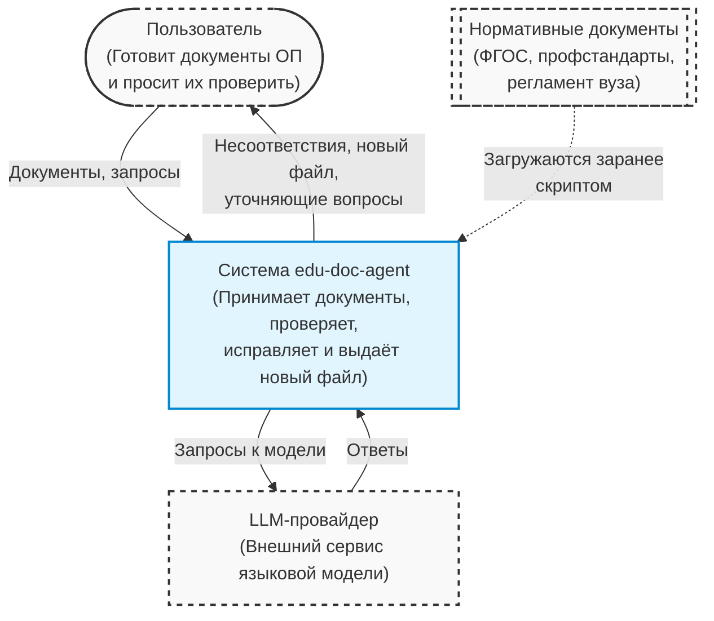
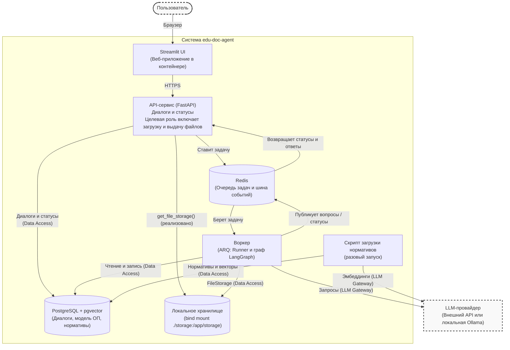
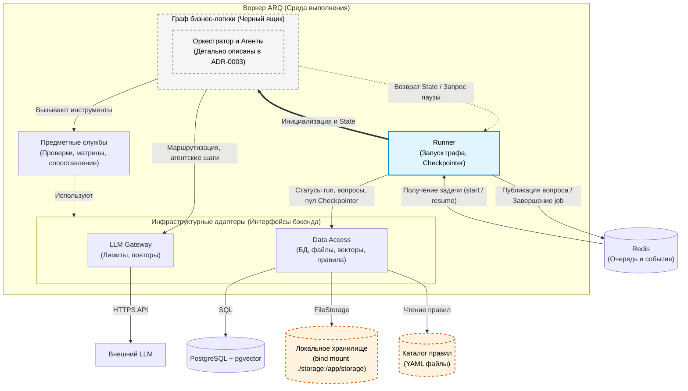

# Архитектура бекенда системы edu-doc-agent

## Архитектурное решение

Бекенд — модульный монолит: один API-сервис и один фоновый воркер на общей кодовой базе. Вместе они превращают диалог с пользователем в процесс «разобрать документы → проверить → исправить → собрать новый документ».

- **Чат как единственный вход:** Пользователь загружает документы, просит проверить их, затем просит исправить конкретное несоответствие.
- **Тонкий API, тяжёлый воркер:** Связка «FastAPI → Redis → Worker». API принимает сообщения и файлы, ставит задачу в очередь Redis, передаёт статус потоком и отдаёт файлы. Парсинг, вызовы LLM и сборка документа идут в воркере, поэтому долгие задачи не блокируют API.
- **Идемпотентность и повторы (Retries & Timeouts):** Повторный запуск с тем же `run_id` не должен дублировать зафиксированные findings, версии документов и другие изменения в БД. Результаты завершённых шагов по возможности кэшируются по идентификатору шага. Внешний вызов может быть выполнен повторно, если сбой произошёл до сохранения его результата.
- **Граф бизнес-логики как чёрный ящик:** Логика воркера построена на LangGraph и представляет собой конечный автомат, а не жёсткий конвейер. Граф разрабатывает ИИ-команда: он сам определяет намерение, направляет задачу в один из подграфов («Проверка», «Генерация», «Правка», «Вопросы») и управляет общим состоянием (State). Бекенд отвечает за среду выполнения: запуск графа, сохранение State, паузы и общие службы.
- **Human-in-the-loop:** Если графу не хватает данных или возникает неоднозначность, его выполнение приостанавливается. Воркер отправляет через API вопрос пользователю в чат и обработка приостанавливается до постановки новой resume-job. Когда ответ приходит, граф возобновляется с сохранённого состояния.
- **Код считает, LLM читает:** Числа и совпадения проверяет код. LLM нужен, чтобы понять свободный текст документа и написать недостающий фрагмент.
- **Модель ОП вместо файла:** Из загруженных файлов извлекается структурированная модель (дисциплины, компетенции, индикаторы, разделы РПД и связи между ними). Проверки и исправления работают с моделью.
- **Исходный файл не меняется:** Исправление вносится в модель, а из неё и шаблона собирается новый DOCX или PDF.
- **Файловое хранилище** предоставляется через `FileStorage` в слое Data Access. В Compose для API и воркера настроен общий bind mount `./storage:/app/storage`.
- **Происхождение документов:** Происхождение сформированного документа восстанавливается. Хранятся исходная версия документа, неподтверждённый ChangeProposal (предложенное исправление), подтверждение пользователя, результирующая версия и связь derived_from между версиями. Новая версия создаётся только после подтверждения.
- **Управление состоянием (State):** Checkpointer LangGraph сохраняет состояние графа в PostgreSQL при каждом переходе между узлами. Это позволяет возобновлять работу после пауз и поддерживать длительные сессии.
- **Разделение состояния и транспорта:** PostgreSQL выступает единственным источником истины (Source of Truth). Канонический статус выполнения (`queued`, `running`, `waiting_for_input`, `completed`, `failed`, `cancelled`), тексты уточняющих вопросов графа и ответы пользователя сохраняются в реляционных таблицах БД. Redis используется исключительно как эфемерный транспортный слой (очередь задач ARQ) и брокер доставки (Pub/Sub).
- **Самовосстановление при сбоях (Reconciliation):** Поскольку Redis не является источником истины, его внезапный рестарт или жесткое падение воркера (например, по нехватке памяти) не приводят к потере данных. Любые потерянные или зависшие задачи автоматически пересоздаются в очереди фоновым процессом (Reconciler), который опирается на канонические статусы из PostgreSQL.
- **Единое хранилище данных:** Диалоги, модель ОП, найденные несоответствия, состояние графа и векторы нормативов лежат в PostgreSQL с расширением `pgvector`. Отдельной векторной базы нет.
- **Нормативы через RAG:** ФГОС, профстандарты и регламент вуза хранятся в PostgreSQL в виде векторных представлений и индексируются для гибридного (векторного и полнотекстового) поиска.
- **Общие службы:** Ни граф бизнес-логики, ни API не обращаются напрямую к базам и файлам, а граф не обращается напрямую к LLM. Data Access — общий модуль монолита: им пользуются и API, и воркер. Все вызовы идут через `LLM Gateway`, а обращения к данным — через `Data Access`.

## С4, уровень 1: Контекст системы

Пользователь готовит документы ОП и просит их проверить. Он передаёт в систему edu-doc-agent документы и запросы, а получает несоответствия и новый документ. Если системе не хватает данных, она сама задаёт пользователю уточняющий вопрос в чате и продолжает работу после ответа.

Из внешних сервисов системе нужен только LLM-провайдер: она отправляет ему запросы к модели и получает ответы. Нормативные документы загружаются в PostgreSQL заранее скриптом и в рабочем режиме внешней интеграцией не являются.

## С4, уровень 2: Контейнеры

Веб-интерфейс, один API, один воркер, Redis и два хранилища; вовне только LLM.

- **Streamlit UI** — чат-интерфейс в браузере. Общается только с API.
- **API-сервис (FastAPI + Uvicorn)** отвечает за диалоги, статусы и постановку задач. Через общий модуль Data Access он пишет диалоги в PostgreSQL, доставляет в чат вопросы воркера к пользователю и принимает ответы. В файловом контуре API реализована зависимость `get_file_storage()`, которая предоставляет `FileStorage`.
- **Redis** служит исключительно транспортным слоем (очередь задач ARQ и доставка событий). Он не является источником истины: при его рестарте система восстанавливает каноническое состояние из PostgreSQL.
- **Воркер (ARQ)** запускает граф бизнес-логики на LangGraph в среде выполнения Runner. Он читает и пишет данные в PostgreSQL, читает каталог правил (YAML) и обращается к LLM-провайдеру. При запуске воркера `FileStorage` добавляется в контекст ARQ под ключом `storage`.
- **PostgreSQL с pgvector** — хранит диалоги, канонические статусы задач, модель ОП, несоответствия, состояние графа и векторы нормативов.
- **Локальное хранилище** использует общий каталог на хосте Compose. Файловые операции выполняет `LocalFileStorage` из Data Access.
- **Скрипт загрузки нормативов** запускается вручную один раз. Использует предметные модули (`parsing/` и `retrieval/`) для парсинга текстов и получения векторов, которые, в свою очередь, работают строго через инфраструктурные адаптеры (DAO и LLM Gateway).

*Технологии: Python 3.12, FastAPI, Pydantic 2, Streamlit, Redis + ARQ, LangGraph, PostgreSQL 17 + pgvector, Docker Compose.*

## Файловое хранилище

`FileStorage` и `LocalFileStorage` экспортируются из `edu_doc_agent.dao`.
Локально `STORAGE_DIR` по умолчанию равен `./storage` относительно рабочего
каталога. Пустое значение также выбирает этот каталог. Compose задаёт
`STORAGE_DIR=/app/storage` для API и воркера и монтирует в оба контейнера
один каталог проекта как `./storage:/app/storage`.

| Операция | Результат |
| --- | --- |
| `save(session_id=…, doc_id=…, filename=…, content=…)` | Сохраняет байты и возвращает относительный `storage_key`. Повторное сохранение по тому же ключу атомарно заменяет обычный файл. Если проверка обнаруживает каталог, символическую ссылку или специальный файл, операция завершается с `InvalidStoragePathError` и сохраняет объект на месте. |
| `read(storage_key)` | Возвращает байты обычного файла. Если такого файла нет, в том числе если он исчез до открытия, чтение завершается исключением `StorageFileNotFoundError`. |
| `exists(storage_key)` | Возвращает `True`, если ключ указывает на обычный файл. |
| `delete(storage_key)` | Возвращает `True` после удаления обычного файла. При отсутствии файла или наличии специального файла, например FIFO, возвращает `False`. Попытка удалить каталог вызывает `InvalidStoragePathError`. |

При конкурентном доступе гарантия сохранения таких объектов действует, если
каталоги сессий изменяются только через `FileStorage`. Проверка типа и
публикация через `os.replace` выполняются отдельными операциями. Если
сторонний процесс создаст FIFO или символическую ссылку между ними,
`os.replace` может заменить эту запись в каталоге. При замене символической
ссылки её цель остаётся нетронутой.

Для каждой сессии `save` размещает новые файлы в `sessions/<sha256(session_id)>`
относительно `STORAGE_DIR`. `session_id` — непустая строка UTF-8 без `U+0000`.
SHA-256 вычисляется от полного идентификатора с учётом регистра. Разделители
пути в идентификаторе хешируются как часть строки. `doc_id` принимает UUID
или строку из букв ASCII, цифр, точек, дефисов и подчёркиваний.
Ключ учитывает `doc_id` и полное исходное имя файла до обрезки. Каждый
компонент пути занимает до 255 байт в UTF-8. При обрезке сохраняется расширение,
если оно помещается. В `read`, `exists` и `delete` передаётся целиком ключ,
полученный из `save`.

Абсолютные пути, символические ссылки и ключи с пустыми компонентами, `.`,
`..` или обратной косой чертой вызывают `InvalidStoragePathError`. В имени
файла отклоняются оба разделителя пути. Имена файлов и ключи с управляющими
символами ASCII `U+0000`–`U+001F` или `U+007F` также отклоняются.
Ранее выданные относительные ключи обычных файлов остаются пригодны для
чтения, проверки существования и удаления.

Файловые операции выполняются в отдельном потоке. При отмене `save` и
`delete` дожидаются окончания начатой операции даже при повторной отмене
и только затем передают `CancelledError`. К этому моменту файл уже может
быть записан или удалён. Повтор по тому же ключу после получения отмены
начинается после предыдущей операции.

## С4, уровень 3: Компоненты воркера

Воркер предоставляет среду выполнения (инфраструктуру и общие службы) для графа бизнес-логики, который разрабатывает ИИ-команда. Для бекенда граф — чёрный ящик: устройство оркестратора, подграфов и агентов описано в ADR-0003 и здесь не дублируется.

**Runner** — инфраструктурная обёртка для запуска графа. Он берёт задачу из ARQ, инициализирует Checkpointer (на пуле Data Access) и вызывает граф.
Если граф запрашивает данные у пользователя (Human-in-the-loop), Checkpointer автоматически сохраняет State в PostgreSQL. Runner сохраняет в PostgreSQL статус run `waiting_for_input` и успешно завершает текущую ARQ job. Ответ пользователя создаёт новую job на возобновление. Runner получает её, загружает сохранённый State и продолжает выполнение графа.

**Граф бизнес-логики** получает State и общие службы, выполняет сценарии «Проверка», «Генерация», «Правка» и «Вопросы» и возвращает обновлённый State либо запрос паузы. Его внутреннее устройство бекенд не определяет.

**Предметные службы и инфраструктура:**

Для изоляции бизнес-логики от работы с базами данных введён промежуточный слой:

- **Предметные службы (Domain Services):** Реализуют инструменты графа из ADR-0003 (проверки, сопоставление, построение матрицы покрытия, генерация). Службы выполняют всю математику и бизнес-логику, оркестрируя данные, но сами не работают с БД напрямую.
- **Инфраструктурные адаптеры:**
  - **LLM Gateway:** Контроль лимитов, повторов, учёт токенов; единственная точка выхода к LLM-провайдеру.
  - **Data Access (DAO):** Общая служба монолита для API, воркера и предметных служб. Выполняет исключительно I/O операции: чтение и запись в PostgreSQL (модель ОП, состояние графа), гибридный поиск, работу с файлами через `FileStorage` и парсинг YAML-правил. Любая бизнес-логика в DAO строго запрещена.

Граф не ходит напрямую ни в базы, ни в файлы, ни в LLM: он вызывает предметные службы, а те работают через инфраструктурные адаптеры (DAO и LLM Gateway). Исключение: для определения намерений и маршрутизации граф обращается к LLM Gateway напрямую.

**Каталог правил** — YAML-файлы с правилами проверки (`rules/*.yaml`). Предметные службы читают их через Data Access и используют при проверке. Формат каталога — в открытых вопросах.

### Асинхронная обработка документов (API + ARQ)

Для предотвращения блокировки API-сервера при долгих задачах (парсинг РПД, запросы к LLM), обработка сессий вынесена в фоновые воркеры с использованием Redis и библиотеки ARQ.

**Текущее поведение.** Контур FastAPI → PostgreSQL → Redis → ARQ worker работает со статусами в БД. Бизнес-логика пока заглушка, граф LangGraph подключается позже.

Запуск обработки: `POST /api/v1/sessions/{session_id}/process`.

1. API в одной короткой транзакции гарантирует существование `Session` (идемпотентный upsert, два параллельных запроса не падают на первичном ключе) и создаёт `Run` со статусом `queued`.
2. Только после commit API вызывает `ArqRedis.enqueue_job()` с `session_id`, `run_id` и `_job_id=str(run_id)`.
3. Если постановка не подтверждена (таймаут 2 с, Redis недоступен, `enqueue_job()` вернул `None`, внутренняя ошибка), API переводит `Run` в `failed`, только если он всё ещё `queued` и `reconcile_attempts=0`. Запоздалая компенсация не меняет run, уже взятый worker или восстановленный Reconciler в новом поколении.

Одновременно допустим один активный run на сессию (`queued`, `running`, `waiting_for_input`). Гарантию даёт частичный уникальный индекс `uq_runs_active_session`. API превращает в `409` только нарушение этого индекса, остальные ошибки целостности не маскируются.

Ответы `POST /api/v1/sessions/{session_id}/process`:

* **`202 Accepted`** — ARQ подтвердил постановку. Тело: `run_id`, `session_id`, `status=queued`. API не ждёт выполнения.
* **`409 Conflict`** — в сессии уже есть активный run. Новый run не создаётся, в очередь ничего не ставится.
* **`503 Service Unavailable`** — Redis недоступен, подтверждение не получено за 2 секунды либо `enqueue_job()` вернул `None`. ARQ возвращает `None` в том числе при `WatchError` после обрыва соединения, поэтому это не доказывает конфликт идентификатора. Исход записи в Redis неизвестен: задание могло сохраниться. API делает одну попытку на запрос и не повторяет её. Созданный run компенсируется в `failed`, если ещё находится в `queued` исходного поколения 0.
* **`500 Internal Server Error`** — непредвиденная ошибка при постановке. Run компенсируется так же.

Запрос статуса: `GET /api/v1/sessions/{session_id}/runs/{run_id}`.

* Читает данные из PostgreSQL строго по паре `(session_id, run_id)`, Redis не используется. Эндпоинт предназначен для поллинга со стороны UI.
* **`200 OK`** — тело `RunStatusResponse`: `run_id`, `session_id`, `status` (`queued`, `running`, `waiting_for_input`, `completed`, `failed`, `cancelled`), `created_at`, `updated_at`.
* `updated_at` — время последнего перехода в статус. Heartbeat, подтверждение доставки и обход очереди сохраняют его. Служебные поля восстановления не входят в HTTP-ответ.
* **`404 Not Found`** — run не существует либо принадлежит другой сессии.

**Worker и `SessionRunner`.** `process_session_task` — тонкая точка входа: берёт `SessionRunDAO` из `ctx` и вызывает `SessionRunner.execute()`. Вся работа со статусами внутри `SessionRunner`:

1. Атомарный переход `queued → running` с проверкой `reconcile_attempts = expected_reconcile_attempts`. У исходной API-задачи поколение 0; восстановленная job получает его явно в payload. Если статус или поколение не совпали, бизнес-функция не вызывается и задача возвращает `status=skipped`. Поколение проверяется также при heartbeat и последующих изменениях статуса. Номер попытки ARQ `job_try` не заменяет эту проверку.
2. Вызов бизнес-функции внутри корутины: поддерживается любой `Awaitable`, включая `Future`. Синхронное исключение при вызове проходит через тот же обработчик ошибок, что и исключение при ожидании результата. Транзакция БД на время работы графа не удерживается: каждое изменение статуса идёт в отдельной короткой сессии.
3. Успех при действующем lease: сразу инициируется `running → completed` с проверкой поколения, до ожидания очистки heartbeat. Подтверждённый переход останавливает таймер lease; задержанная очистка не возвращает run в активный статус и не разрешает его восстановление. Ошибка записи `completed` распространяется, не переклассифицируя успешную бизнес-операцию в `failed`.
4. Необработанное исключение: `queued|running → failed`, затем исключение пробрасывается в ARQ.
5. `asyncio.CancelledError`: Runner дожидается начатой операции смены статуса, включая закрытие её DB-сессии. Hook `on_job_start` заранее сохраняет монотонный срок выполнения из `WorkerSettings.job_timeout` — той же настройки, которую использует ARQ. Если срок истёк, ещё выполняющийся run переводится в `failed`. При остановке worker до этого срока Runner возвращает захваченный run в `queued`, а на последней попытке переводит в `failed`. Уже записанный терминальный статус сохраняется; run, захваченный другим выполнением, не меняется. Повторная отмена не прерывает запись. Затем отмена пробрасывается в ARQ.

В текущей конфигурации длительность job ограничивает ARQ (`job_timeout=600` секунд), дополнительного внутреннего лимита 570 секунд нет. Срок в `ctx` нужен только для классификации отмены и не создаёт собственного таймера. При достижении таймаута ARQ отменяет coroutine и фиксирует `TimeoutError` без автоматического retry; Runner до выхода отмены сохраняет `failed`, освобождая слот для нового POST. При остановке worker до срока ARQ получает `CancelledError` и может повторить тот же run. Обычное исключение бизнес-функции, включая её собственный `TimeoutError`, переводит run в `failed` и распространяется в ARQ без автоматического retry. Новая классификация временных ошибок пока не реализована.

**Восстановление зависших запусков (текущая реализация).** Сценарии, при которых run остаётся в активном статусе без живого воркера или задачи в очереди (падение API между commit и `enqueue_job()`, жёсткое падение воркера по OOM, сброс Redis, исчерпание `max_tries` до вызова Runner, временная недоступность БД при записи итогового статуса), обрабатываются связкой Heartbeat и `RunReconciler`:

- Во время выполнения бизнес-логики `SessionRunner` запускает фоновую корутину, которая каждые `RUN_HEARTBEAT_INTERVAL_SECONDS` (по умолчанию 30 с) обновляет `last_heartbeat_at` в PostgreSQL. При потере lease бизнес-функция принудительно отменяется (`status=conflict`). Бизнес-логика и тяжёлые синхронные операции (парсинг, извлечение, синхронный LLM-клиент) не должны блокировать event loop (использовать `asyncio.to_thread`), иначе Heartbeat не сможет обновлять пульс.
- Ошибки и зависание heartbeat допускаются только до локального срока lease, равного `RUN_STALE_RUNNING_SECONDS`. Срок отсчитывается по монотонным часам от начала запроса захвата или последнего подтверждённого heartbeat, а не от получения ответа БД. Независимый `loop.call_at` по этому сроку отменяет бизнес-корутину, даже если heartbeat ещё ждёт закрытия сессии или rollback. После подтверждённого пульса таймер переносится. При потере lease до завершения бизнес-операции Runner дожидается очистки БД и возвращает `conflict` без записи терминального статуса. Если операция успешно завершилась при действующем lease, Runner сначала фиксирует `completed` с проверкой поколения и затем ждёт очистки heartbeat; истечение прежнего срока во время этой очистки не отменяет записанный успех. Первый пульс планируется от начала запроса захвата: если ответ задержался дольше интервала, он отправляется сразу. Бизнес-логика должна своевременно обрабатывать отмену: отмена `asyncio.to_thread` сама по себе не останавливает функцию в потоке. Внешняя отмена Runner распространяется и при одновременном завершении heartbeat; уже зафиксированный терминальный статус сохраняется.
- `RunReconciler` (`reconcile_stale_runs_task`) ставится в очередь при старте воркера (`run_at_startup=True`) и далее каждую минуту по cron в `WorkerSettings`. Это не барьер перед приёмом обычных задач. Отдельный вызов в `on_startup` нужен только при отдельном требовании завершить восстановление до начала их обработки.
- Запуски в статусе `running` без пульса дольше `RUN_STALE_RUNNING_SECONDS` (по умолчанию 120 с; при старте валидируется `RUN_STALE_RUNNING_SECONDS >= 2 * RUN_HEARTBEAT_INTERVAL_SECONDS`) и `queued` старше `RUN_STALE_QUEUED_SECONDS` (120 с), отсутствующие в очереди Redis, атомарно переводятся в `queued` с инкрементом `reconcile_attempts` и повторно ставятся в ARQ с уникальным `_job_id="{run_id}:reconcile:{reconcile_attempts}"`.
- Резервирование поколения устанавливает `reconcile_pending=true`. При отмене cron или сбое Redis следующий проход повторяет отправку того же поколения и `_job_id`. Поколение никогда не уменьшается. Подтверждённый enqueue, наличие job в очереди, сохранённый результат ARQ этого job ID или атомарный захват worker сбрасывают этот признак для ожидаемого поколения. Результат ARQ подтверждает доставку, но не меняет канонический статус run: если он остался queued, следующий проход применяет обычное восстановление или лимит. Пока доставка ожидается, новое поколение не резервируется и лимит не считается исчерпанным. Компенсация исходного POST может перевести в failed только queued-поколение 0 и не затрагивает восстановленные поколения.
- Если `reconcile_attempts >= RUN_MAX_RECONCILE_ATTEMPTS` (по умолчанию 3) и доставка подтверждена, зависший запуск переводится в терминальный статус `failed` (защита от poison pill).
- Проверка и отправка используют `redis.default_queue_name` из пула worker; явное имя можно передать через `ctx["queue_name"]`. Кандидаты `queued` отбираются и сортируются по `coalesce(last_queue_check_at, updated_at), id`. Проверка job и резервирование следующего queued-поколения обновляют служебный `last_queue_check_at`, поэтому обход доходит до следующих страниц. Публичный `updated_at` сохраняет время перехода в текущий статус: heartbeat, подтверждение доставки и проверки очереди его не меняют.
- Восстановленные `running` отправляются сразу после резервирования. Для `queued` доставка начинается после проверки каждого кандидата, до перехода к следующему: медленный обход всей страницы не откладывает все отправки до конца прохода.

Параметры читаются из окружения или `.env` при старте API/worker:

| Настройка | По умолчанию | Ограничение |
| --- | --- | --- |
| `RUN_HEARTBEAT_INTERVAL_SECONDS` | 30 с | Положительное конечное число |
| `RUN_STALE_RUNNING_SECONDS` | 120 с | От `2 × RUN_HEARTBEAT_INTERVAL_SECONDS` до 31 536 000 с включительно |
| `RUN_STALE_QUEUED_SECONDS` | 120 с | Положительное конечное число, не более 31 536 000 с |
| `RUN_MAX_RECONCILE_ATTEMPTS` | 3 | Целое число, не менее 1 |

Оба порога устаревания должны быть конечными. Верхний предел в 365 дней
обеспечивает безопасное вычисление `clock_timestamp() - interval` в PostgreSQL;
`inf`, `nan` и слишком большие конечные значения отклоняются при загрузке настроек.
Поля `reconcile_pending` (по умолчанию `false`) и `last_queue_check_at` (по умолчанию
`NULL`) добавляются одной миграцией ветки `a6e91f0b2c43`.

**Обновление потребителей очереди.** Текущая поставка обновляется с остановкой сервиса: остановить старые API и все worker, применить миграцию, запустить новые API и worker (команды — в [README](../README.md)). В общей очереди нельзя смешивать старый worker и новые задачи с `expected_reconcile_attempts`. При поочерёдном обновлении Reconciler должен включаться только после замены всех потребителей; отдельного переключателя для этого режима сейчас нет.

**Ограничения текущей реализации.** После внедрения Heartbeat и `RunReconciler` остаются следующие ограничения:

- параметры `job_timeout` и `max_tries` заданы константами в `worker/settings.py` и не вынесены в `.env`;
- классификация временных ошибок для автоматического retry пока не реализована;
- статус `waiting_for_input` не охвачен Reconciler'ом (TTL на ожидание ответа пользователя не задан).

**Границы и приёмка issue #47.** В задачу входят восстановление устаревшего `running`, доставка потерянного `queued` и перевод в `failed` при исчерпании подтверждённых восстановлений. Каждый сценарий проверяется отдельно на уровне unit и с настоящими PostgreSQL, Redis и ARQ. Приёмка также включает безопасную передачу владения при возвращении старого worker: его токен не позволяет завершить, провалить, переочередить или обновить heartbeat нового поколения. При неизвестном исходе записи в Redis проверяются оба случая — запись состоялась и запись не состоялась; повторный проход сохраняет поколение и обеспечивает одно выполнение. После `completed` или `failed` GET возвращает терминальный статус, а повторный POST той же сессии получает `202` с новым `run_id` вместо `409`.

`waiting_for_input`, возобновление графа и политика повторов LLM остаются отдельными задачами. Завершение восстановления до приёма обычных задач в приёмку #47 не входит.

**Целевой контракт.** Активность run определяется каноническим состоянием в PostgreSQL. Разрешён один активный run на сессию со статусом `queued`, `running` или `waiting_for_input`. Попытка создать ещё один активный run должна возвращать `409`. Завершение отдельной ARQ job само по себе не разрешает новый run. При `waiting_for_input` run сохраняет активный статус после завершения текущей job. Ответ пользователя создаёт отдельную resume-job того же run. Сохранённый результат ARQ не определяет активность run.

### Жизненный цикл задачи и идентификаторы

Для корректного возобновления графа после пауз и исключения коллизий, бекенд опирается на строгую связку идентификаторов:
- **`session_id` (API)** = **`thread_id` (LangGraph)**: Сквозной идентификатор диалога пользователя с конкретной моделью ОП. Именно по нему Checkpointer находит нужный State в PostgreSQL при возобновлении после паузы.
- **`run_id`**: Стабильный идентификатор одного логического выполнения. Сохраняется при автоматических повторах и возобновлении после `waiting_for_input`. Используется для идемпотентной записи результатов в БД.

  В целевой схеме API разрешён строго один активный run на сессию; активность хранится в PostgreSQL.
- **`job_id` (ARQ)**: Идентификатор отдельной фоновой задачи ARQ. Сейчас исходная job использует `str(run_id)`, восстановленная — `{run_id}:reconcile:{reconcile_attempts}`. При повторе неподтверждённой доставки ID и поколение сохраняются; обычный retry ARQ также сохраняет их и меняет только `job_try`. Отдельные resume-job относятся к целевому сценарию возобновления после уточнений.
- **`program_id`**: Идентификатор конкретной образовательной программы в БД (модели ОП), привязанный к `session_id`.

**Состояния сессии (session):**
Сессия — это долгоживущий контейнер диалога, который существует независимо от отдельных запусков задач.
- `active` — сессия активна, отображается в интерфейсе, в рамках неё ведется работа и инициируются запуски (runs).
- `archived` — сессия скрыта из активного интерфейса. Физически данные сохраняются в БД для аудита (отслеживание связей `derived_from` между версиями документов), сбора аналитики и истории диалогов.

**State machine выполнения (run):**
1. `queued` — API принял файлы/сообщение и поставил задачу в Redis.
2. `running` — Воркер ARQ взял задачу и крутит граф.
3. `waiting_for_input` — Граф запросил данные, воркер завершил работу и освободил память. Система ждёт HTTP-запроса от пользователя.
4. `queued` — Пользователь ответил. API сохранил ответ, перевёл текущий run в `queued` и поставил в Redis задачу на возобновление.
5. `running` — Воркер взял задачу на возобновление из очереди, граф продолжает выполнение.
6. `completed` / `failed` / `cancelled` — Терминальные статусы выполнения (run). Пользователь может явно отменить текущую операцию через API, переведя активный run в статус `cancelled`, чтобы инициировать новую проверку без ответа на ожидающий вопрос.

**Таймауты и правила повторов (ARQ):**
Целевые правила для длительных графов с LLM перечислены ниже. Сейчас `job_timeout=600` и `max_tries=3` заданы в `worker/settings.py`; настройка через `.env` и классификация временных ошибок ещё не реализованы. Текущее поведение при отмене и таймауте описано выше.
- **Таймаут (job_timeout):** Увеличенный (по умолчанию 10–15 минут), чтобы граф успел сделать несколько последовательных запросов к LLM и выполнить тяжелый RAG.
- **Повторы при временных ошибках (`max_tries`):** Задача может быть автоматически повторена при timeout, rate limit и временной недоступности внешнего сервиса или БД. Ошибки валидации, некорректные входные данные и программные ошибки переводят run в `failed` без автоматического повтора. Максимальное число попыток для временных ошибок — 3.

**Отказоустойчивость и восстановление при жестких сбоях (Reconciliation & Heartbeat):**
Механизм ARQ не может спасти задачу, если процесс воркера убит операционной системой (например, по OOM) или произошел сброс Redis. Для защиты от зависания задач и предотвращения двойного запуска введен механизм Lease/Heartbeat:
- **Heartbeat:** Пока воркер выполняет задачу (статус `running`), фоновая сопрограмма каждые `RUN_HEARTBEAT_INTERVAL_SECONDS` (по умолчанию 30 с) обновляет метку `last_heartbeat_at` для текущего `run_id` в PostgreSQL с проверкой поколения (`reconcile_attempts`) как fencing token.
- **Reconciler:** Периодическая cron-задача ARQ (`run_at_startup=True`, далее раз в минуту с таймаутом 30 с) восстанавливает устаревшие `running` и потерянные `queued` по правилам раздела «Восстановление зависших запусков» выше. Новое поколение получает `reconcile_pending=true`; сбой доставки сохраняет поколение для повторной отправки. Подтверждённый enqueue, наличие job в очереди, сохранённый результат ARQ или захват worker подтверждают доставку для этого поколения. Обход очереди использует отдельную временную метку и не меняет публичное время статуса.
- **Защита от фатальных задач (Poison Pill):** Если подтверждённые восстановления достигли лимита `RUN_MAX_RECONCILE_ATTEMPTS` (по умолчанию 3), зависший запуск переводится в `failed`. Неподтверждённая доставка повторяется с тем же поколением без расхода следующей попытки.

## Инфраструктурные модули backend

| Модуль | Ответственность | Статус |
| --- | --- | --- |
| `api/` | HTTP-слой: роутеры, схемы запросов и ответов, постановка задач в очередь. | M2 |
| `worker/` | Runner на ARQ: запуск графа, управление паузами, таймаутами, повторами и идемпотентностью. | M2 |
| `llm/` | LLM Gateway: единый шлюз к провайдерам (клиент, кэш, ретраи, лимиты). | M2 |
| `dao/` | Data Access: модели SQLAlchemy, миграции Alembic, сессии; `FileStorage` и `LocalFileStorage`; чтение каталога правил (YAML). | M2 |

## Стек

- **Язык:** Python 3.12.
- **API:** FastAPI + Uvicorn.
- **Валидация и схемы:** Pydantic 2.x (плюс `pydantic-settings` для конфигурации).
- **Очередь и события:** Redis + ARQ (для фонового Воркера). На уровне инфраструктуры заданы таймауты выполнения и правила повторов (retry), а сами фоновые задачи строго идемпотентны.
- **Оркестрация агентов (Инфраструктура):** LangGraph (на стороне бекенда обеспечивается Checkpointer поверх PostgreSQL через AsyncPostgresSaver).
- **LLM (Gateway):** внешний провайдер + возможность запускать локальную модель через Ollama (профиль `local-llm` в `compose.yaml`).
- **БД и RAG:** PostgreSQL 17 с расширением pgvector (единое хранилище для реляционных данных и векторов).
- **ORM и миграции:** SQLAlchemy + Alembic.
- **Файловое хранилище** работает через `LocalFileStorage` на общем bind mount API и воркера.
- **Каталог правил:** YAML-файлы (`rules/*.yaml`).
- **Инфраструктура:** Docker Compose, GitHub Actions, GitHub Container Registry.

## Данные и конфигурация
Расположение тестовых данных, правила работы с переменными окружения (`.env`) и глобальные открытые вопросы проекта зафиксированы в главном файле [architecture.md](architecture.md).
